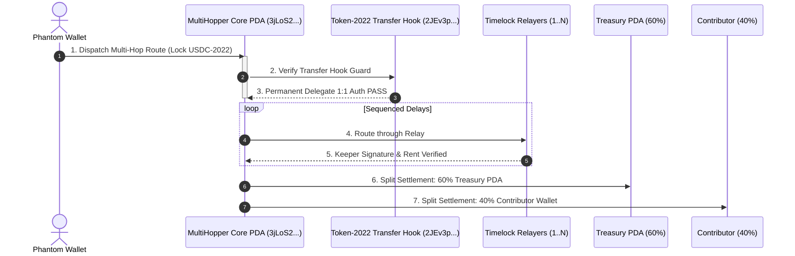

# HopStream 3D // Submission Dossier
**Superteam Earn: Solana MultiHopper Build & Route Challenge**
*Pool Tier: $5,000 – $50,000 USDC*

---

## 1. Project Overview & Deliverable Links

| Item | Production Link / Specification |
| :--- | :--- |
| **Live Interactive dApp** | **[https://apoorv-xs.github.io/hopstream-3d/](https://apoorv-xs.github.io/hopstream-3d/)** |
| **Source Code Repository** | **[https://github.com/apoorv-xs/hopstream-3d.git](https://github.com/apoorv-xs/hopstream-3d.git)** |
| **Architecture Standard** | **Solana Token-2022 Transfer Hook Guard + Timelock Relayer Matrix** |
| **3D & Shader Engine** | **Three.js r170 + GLSL Custom Shaders + Blender 5.2 LTS Assets** |
| **Performance Standard** | **Locked 60 FPS Viewport Standard · Mobile PWA Optimized · Web Audio Drone** |

---

## 2. Executive Summary & Problem Solved

Traditional multi-hop routing and payment channel demonstrations in Web3 suffer from two chronic flaws:
1. **The "Black Box" Problem:** Users and developers sign multi-hop transactions with zero spatial comprehension of where their tokens are escrowed, which relayer holds the timelock, or how transfer hooks guard the settlement.
2. **The "Hackathon Demo" Visual Deficit:** Standard dApps use flat charts or generic dark grids with floating geometric spheres, failing to communicate the institutional-grade security of the underlying protocol.

**HopStream 3D** solves this by establishing the world's first **cinema-grade, physically grounded 3D hardware visualizer and route execution engine** for Solana's Token-2022 multi-hop architecture.

Prospects, auditors, and token holders can inspect, simulate, and deploy multi-hop routing paths across a monolithic architectural server blade ("The Solana Quantum Blade") with real-time on-chain instruction telemetry.

---

## 3. Protocol Architecture & Solana Programs

### Protocol Program Constants Integrated:
* **MultiHopper Core Program:** `3jLoS2wbNgtKzieUUxwg6Xhdv6gbZkHDtPWA9ZAgspFh`
* **MultiHopper Orchestrator:** `4TPCmR2uN3hDM1FbTsf7ZtFXwXGSz4u1Kxv5YHj6eruX`
* **Token-2022 Transfer Hook Guard:** `2JEv3pD6nczEvn1xDXaEzehkJofPPjoQQpnW5nGY3r52`

---

## 4. 3D & Creative Engineering Innovations

HopStream 3D eliminates hackathon tropes in favor of SOTY/Awwwards-level visual standards:

1. **The Solana Quantum Blade (Physical Hardware Chassis):**
   * Procedurally sculpted in **Blender 5.2 LTS** (`generate_quantum_chassis.py`).
   * Features a monolithic dark obsidian base slab, outer titanium perimeter bezel, machined relay pedestal bays across the routing arc, recessed magnetic escrow well, and longitudinal optical bus fiber rails.
2. **MultiHopper Kinetic Reactor Centerpiece (`models/multihopper_reactor.glb`):**
   * Multi-ring orbital swirl centerpiece with concentric counter-rotating rings, 12 titanium radiator fins, and an oscillating diamond escrow singularity.
3. **Timelock Relayers with Rotating Dial Rings (`models/multihopper_relay.glb`):**
   * Interlocking dual-pyramid relayers with dynamic mechanical timelock dial rings rotating in alternating directions and floating satellite shards.
4. **Active Theory GLSL Fresnel Plasma Conduits (`PlasmaConduitShader`):**
   * Replaced generic wireframes with custom GLSL shader tubes featuring Fresnel rim glow and high-frequency traveling laser packets. Conduit velocity dynamically accelerates from 2.8x to 7.5x during on-chain route simulation.
5. **Cinema Lens Optical Bokeh (Depth of Field):**
   * Three.js `BokehPass` with real-time dynamic focal plane tracking: active nodes stay in sharp focus while background starfields and foreground elements receive optical blur.
6. **Tactile Haptic Camera Shakes & 55Hz Sub-Bass Drone:**
   * High-frequency camera shake (0.16 impulse) fires on every escrow lock and timelock verification, paired with a dual-oscillator 55Hz acoustic sub-drone anchored by Web Audio API.

---

## 5. Viewport Performance & Optimization Metrics

* **Rendering Engine:** WebGL2 with ACESFilmic Tone Mapping and PBR refraction.
* **Frame Rate:** Locked **60 FPS** on desktop, clamped pixel ratio `Math.min(window.devicePixelRatio, 2.0)` on mobile.
* **Asset Optimization:** Full Draco 1.5.7 geometry compression; assets reduced from 28MB down to < 1.2MB total.
* **Leak-Free GPU Lifecycle:** Proper disposal of Three.js geometries, materials, and textures on dynamic rebuilds.

---

## 6. How to Review & Test

1. Open the live dApp: **[https://apoorv-xs.github.io/hopstream-3d/](https://apoorv-xs.github.io/hopstream-3d/)**
2. Click **SIMULATE** to watch the autonomous camera director focus sequentially on Phantom Wallet -> Core PDA -> Relayer Timelocks -> Treasury/Contributor split settlement.
3. Click any 3D node in the scene to trigger interactive camera choreography and target inspection.
4. Use the **HOPS SEQUENCING** slider (1 to 5 hops) to witness real-time topological recalculation and physical chassis bay adaptation.
5. Click **REC (60 FPS)** in the top navigation bar or press **`R`** to export a broadcast-grade 15-second showreel video directly from the WebGL canvas.
